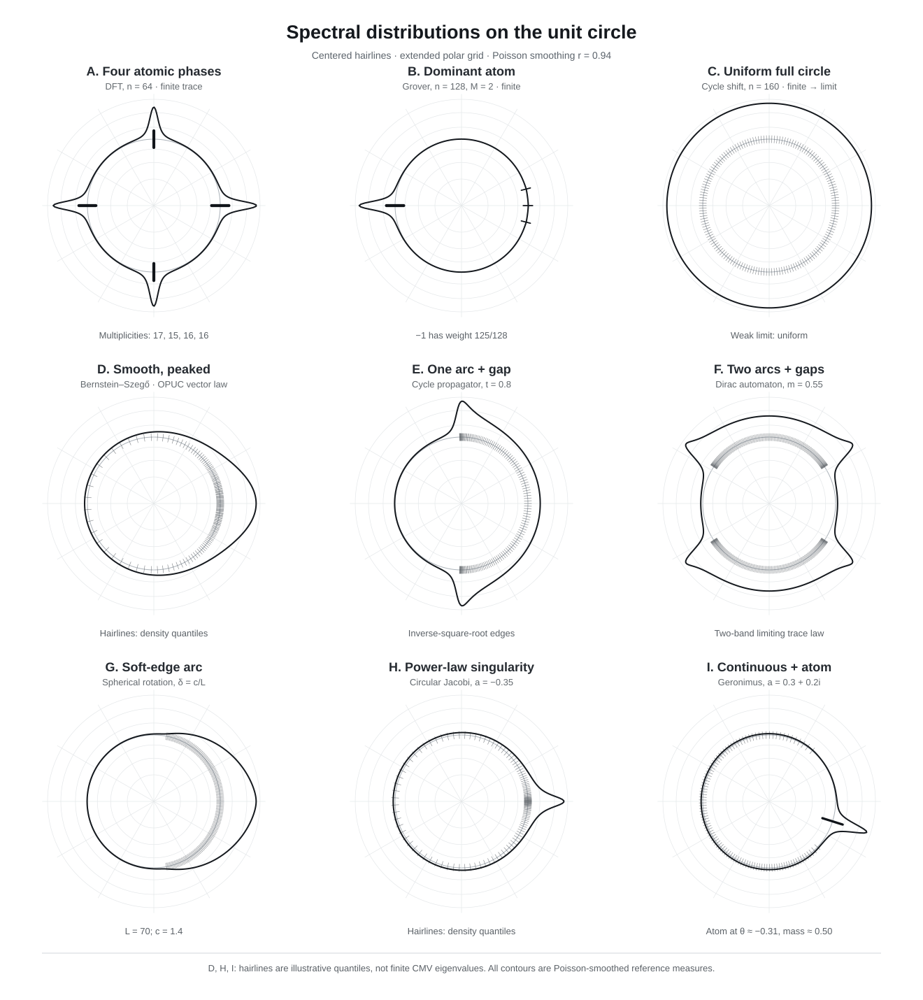
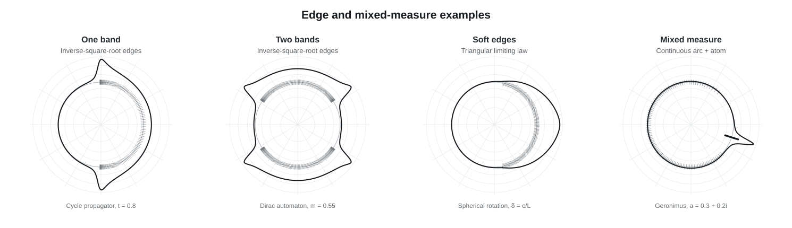

# Spectral Distribution Atlas for Unitary Matrices

**Status:** Illustrated taxonomy and application-reference draft (21 November 2026). Classifications distinguish implemented analytic spectral references from exploratory candidates. Some illustrative hairlines are quantiles, not finite matrix eigenvalues.

## Purpose and mathematical conventions

The atlas groups the spectral **measures and density shapes** occurring among the generators of [`anymatrix-unitary`](../README.md), rather than grouping them by application. The same matrix can belong to several morphological classes. For instance, the large-size Dirac automaton trace law is simultaneously absolutely continuous, two-band, gapped, conjugation symmetric, and singular at band edges.

For a unitary $N\times N$ matrix $U_N$, write $\lambda_j=e^{i\theta_j}$, $\theta_j\in[-\pi,\pi)$. The finite *normalized trace counting measure* is

$$
\mu_N=\frac1N\sum_{j=1}^N\delta_{\theta_j},\qquad
m_k=\int e^{ik\theta}\,d\mu_N(\theta)=\frac{\operatorname{tr}(U_N^k)}{N}.
$$

**Every finite-dimensional measure $\mu_N$ is atomic.** Continuous distributions in this document refer to (i) a verified or derived large-$N$ weak limit of $\mu_N$, (ii) an ensemble average, or (iii) an infinite-dimensional operator's spectral measure at a distinguished vector. These are different quantities and **must not** be exchanged without justification. In particular, a finite CMV matrix's uniform trace weights differ from its Gauss–Szegő quadrature weights and from the infinite OPUC measure.

For a general Borel probability measure $\mu$ on the circle, the Lebesgue decomposition is

$$
 d\mu(\theta)=\rho_{\rm ac}(\theta)\,d\theta+\sum_j w_j\,\delta_{\theta_j}+d\mu_{\rm sc}(\theta).
$$

Here $\mu_{\rm sc}$ is **singular continuous**: it has no atoms but is singular relative to angular Lebesgue measure. The nonnegative density $\rho_{\rm ac}$ need not integrate to one when atoms or a singular-continuous component are present. Throughout, a density is defined **with respect to $d\theta$**, not $d\theta/(2\pi)$; the uniform density is $1/(2\pi)$.

The repository's authoritative interfaces are [`docs/SPECTRAL_REFERENCE.md`](SPECTRAL_REFERENCE.md), [`unitary_spectral_reference.m`](../unitary_spectral_reference.m), and [`metadata/catalog.json`](../metadata/catalog.json). Descriptors `S.finite`, `S.limit`, `S.ensemble`, and `S.underlying` must remain distinct.

## Classification system: several independent axes

### Axis 1 — Type and provenance of the measure

| Tag | Definition | Notes |
|---|---|---|
| `finite:atomic` | Normalized trace measure of any specified finite unitary matrix. | Universal at finite $N$; multiplicities matter. |
| `limit:ac` | Large-$N$ trace law with density $\rho(\theta)$. | Requires a defined sequence of matrices and a justified limit. |
| `limit:atomic` | Large-$N$ trace law with one or more surviving atoms. | High multiplicities can persist after normalization. |
| `limit:mixed` | Limit with both atomic and continuous parts. | Can also have singular-continuous mass. |
| `ensemble:ac` | Expected one-point law of a random ensemble. | Not the density of a finite realization. |
| `underlying:ac` / `underlying:mixed` | Infinite-dimensional cyclic-vector (OPUC/CMV) spectral law. | Not automatically a limiting trace law of finite truncations. |
| `singular-continuous` | Continuous measure singular to Lebesgue measure. | Needs a rigorous spectral-type model; a finite plot cannot establish it. |
| `unknown` | No analytic reference or rigorously identified spectral type. | Do not infer one solely from a finite sample. |

### Axis 2 — Geometry of spectral support

| Tag | Description | What an atlas image should reveal |
|---|---|---|
| `finite-points` | Support at finitely many positions on $\mathbb T$. | Distinct phases, multiplicities, and separation. |
| `full-circle` | Support closure is the entire unit circle. | Uniformity or nonuniformity of angular mass. |
| `one-band` | Support is one proper closed arc. | Two endpoints and the complementary gap. |
| `multi-band` | Support is two or more proper arcs. | Band endpoints and the number/size of genuine gaps. |
| `isolated-atom` | An atom lies away from the continuous support. | A discrete phase inside an open gap. |
| `thin-or-Cantor` | Support has a Cantor-like/fractal structure. | Hierarchical gaps under scale refinement; no claim of density from a finite histogram. |

On the circle, arcs meeting across $-\pi$ and $\pi$ are **connected**; the choice of angle cut must not create an artificial second band. Likewise, an empty region between a finite sample's eigenvalues is not automatically a spectral gap of its limiting support.

### Axis 3 — Local density behavior

| Tag | Analytic feature | Visualization concern |
|---|---|---|
| `constant` | $\rho\equiv 1/(2\pi)$ on the full circle. | Flat baseline. |
| `smooth-peaked` | Smooth positive, nonuniform density; possibly multimodal. | Peak width and small secondary modes. |
| `hard-gap` | Exactly zero density on an open arc. | Smoothing fills the gap artificially. |
| `inverse-sqrt-edge` | $\rho(\theta)\sim C/\sqrt{|\theta-\theta_*|}$ near a band edge, on the occupied side. | Integrable divergence; evaluate analytic reference away from endpoints. |
| `soft-edge` | $\rho\to0$ toward a band endpoint, with some positive power. | Peak-free end of support, unlike inverse-square-root. |
| `cusp-or-power-law` | A zero, divergence, or nondifferentiability at an interior/special phase. | Distinguish algebraic behavior from a narrow smooth peak. |
| `multimodal` | Two or more separated local maxima, with or without gaps. | Multiple peaks need not mean separate support bands. |
| `localized-cluster` | Finite samples concentrate strongly in small angular regions. | Finite-size feature; do not assert an atom in the limit. |
| `degenerate` | Exactly repeated phases. | Count or annotate multiplicity; coincident hairlines are invisible. |

A genuine point mass is **not** an infinite value of $\rho_{\rm ac}$; it belongs in the atomic component. Conversely, a narrow but smooth Poisson/Bernstein–Szegő peak is not an atom.

### Axis 4 — Additional spectral organization

- `conjugate-symmetric`: eigenphases occur at $\pm\theta$ for real orthogonal matrices, with possible eigenvalues $\pm1$.
- `pi-paired`: special drive/symmetry models can pair phases separated by $\pi$; verify for the specific model and sector.
- `wrapped` / `aliased`: $\theta$ arises by reduction of a real dispersion or quasienergy modulo $2\pi$.
- `sector-dependent`: pooled and individual symmetry sectors can have different multiplicities and apparent density.
- `parameter-transition`: band closure, gap opening, an atom entering/leaving the spectrum, or a change of spectral type under parameter variation.
- `level-correlated`: a statistical property **not determined by the one-point density** (e.g. CUE repulsion versus independently distributed uniform points).

## Illustrative figures

### Figure 1. Classification plate



**Caption.** The atlas plate uses the current preferred visualization style: centered eigenphase hairlines, an extended polar grid beyond the unit circle, and an outward Poisson-smoothed density contour with default parameter $r=0.94$. Panels D, H, and I use deterministic quantile positions for the specified infinite OPUC vector measure, not finite CMV eigenvalues; panels A–C and E–G use exact finite phases (some with multiplicities). Contours smooth the correct reference measure, not necessarily a sample histogram. Different panels have independently scaled radial displacements.

### Figure 2. Edge and singularity gallery



**Caption.** Supplementary panels for one-band and two-band inverse-square-root edges, a soft-edge triangular trace limit, and a continuous Geronimus arc with a point mass. Positive Poisson smoothing does not preserve exact spectral gaps.

## Spectral classes with application references

### 1. Atomic and concentrated-point spectra

**Main shapes.** Finite support, often with multiplicity or a dominant atom; may include a few outlier phases.

**Representative generators.** `discrete_fourier`, `grover_operator`, `orthogonal_blocks`, synthetic `diagonal_phase` benchmarks.

**Illustrative panels.** Figure 1A–B.

**Applications.**
- Fourier and transform-based signal processing.
- Quantum search and amplitude amplification.
- Structured orthogonal/unitary building blocks in fast transforms.

**Important references.**
- J. W. Cooley and J. W. Tukey, “An algorithm for the machine calculation of complex Fourier series,” *Math. Comp.* 19 (1965), 297–301.
- L. K. Grover, “A fast quantum mechanical algorithm for database search,” *STOC* (1996), 212–219. [DOI](https://doi.org/10.1145/237814.237866).
- N. J. Higham, *Functions of Matrices*, SIAM, 2008, for matrix-function and transform contexts.

**Database note.** This class is ideal for testing whether smoothing preserves small masses or obscures multiplicities.

### 2. Uniform full-circle laws

**Main shapes.** Support fills the full unit circle with nearly flat angular mass.

**Representative generators.** `cycle_shift` (limiting trace), `haar_unitary` and `circular_beta` (ensemble mean), `haar_orthogonal` (asymptotically uniform counting law).

**Illustrative panel.** Figure 1C.

**Applications.**
- Random matrix models of quantum chaos.
- Baseline test cases for spectral-density estimators.
- Uniform phase benchmarks for randomized numerical linear algebra.

**Important references.**
- F. Mezzadri, “How to generate random matrices from the classical compact groups,” *Notices AMS* 54 (2007), 592–604. [arXiv](https://arxiv.org/abs/math-ph/0609050).
- M. L. Mehta, *Random Matrices*, 3rd ed., Elsevier, 2004.
- P. Diaconis and M. Shahshahani, “The subgroup algorithm for generating uniform random variables,” *Prob. Engrg. Inform. Sci.* 1 (1987), 15–32.

### 3. Smooth nonuniform full-circle laws

**Main shapes.** Support is the whole circle, but the density has one or more broad peaks rather than being flat.

**Representative generators.** `bernstein_szego`, `rogers_szego`, `circular_jacobi`, `jacobi_szego` (all as underlying analytic laws); synthetic `diagonal_phase` or `phase_circulant` can also realize prescribed smooth angular profiles.

**Illustrative panels.** Figure 1D and 1H.

**Applications.**
- OPUC/CMV models and spectral approximation.
- Circular statistics and wrapped distributions.
- Random matrix weights, Toeplitz determinants, and Coulomb-gas models.

**Important references.**
- B. Simon, *Orthogonal Polynomials on the Unit Circle*, Parts 1–2, AMS, 2005. [Part 1](https://doi.org/10.1090/coll054.1), [Part 2](https://doi.org/10.1090/coll/054.2).
- P. Bourgade, A. Nikeghbali, and A. Rouault, “Circular Jacobi ensembles and deformed Verblunsky coefficients,” *Int. Math. Res. Not.* 2009, 4357–4394. [DOI](https://doi.org/10.1093/imrn/rnp092).
- M. J. Colbrook, “Computing spectral measures and spectral types,” *Commun. Math. Phys.* 384 (2021), 433–501.

**Database note.** These measures are especially useful for testing bias in smoothed estimators without the complication of genuine spectral gaps.

### 4. One-band continuous laws with hard gaps

**Main shapes.** Density occupies one proper arc of the circle, vanishing identically on its complement.

**Representative generators.** `cycle_propagator`; in suitable parameter scalings also `spherical_harmonic_rotation` gives one-band support with soft rather than singular edges.

**Illustrative panels.** Figure 1E and Figure 2 (leftmost).

**Applications.**
- Propagation on periodic lattices and cycle graphs.
- Discrete wave and Schrödinger flows on periodic grids.
- Phase wrapping of simple dispersion relations.

**Important references.**
- L. N. Trefethen and M. Embree, *Spectra and Pseudospectra*, Princeton, 2005, for circulant propagation and phase pictures.
- P. J. Davis, *Circulant Matrices*, 2nd ed., AMS Chelsea, 1994.
- Repository spectral reference for `cycle_propagator`: wrapped arcsine law and Bessel moments.

**Theoretical caution.** The illustrated circular contour is a Poisson-regularized measure: it is not a plot of the unsmoothed density itself at singular endpoints, and a smoothed contour can appear in a true gap.

### 5. Multiband and gapped continuous laws

**Main shapes.** Two or more arcs separated by genuine gaps; often with symmetry pairing.

**Representative generators.** `dirac_automaton`, `periodic_cmv`, `split_step_walk`, some Floquet and quantum-walk families.

**Illustrative panels.** Figure 1F and Figure 2 (second panel).

**Applications.**
- Discrete-time quantum walks and quantum cellular automata.
- Floquet topological phases and quasienergy band theory.
- Periodic CMV operators and transfer-matrix models.

**Important references.**
- A. Bisio, G. M. D’Ariano, and A. Tosini, “Quantum field as a quantum cellular automaton: The Dirac free evolution in one dimension,” *Ann. Phys.* 354 (2015), 244–264. [DOI](https://doi.org/10.1016/j.aop.2014.12.016).
- B. Simon, *Orthogonal Polynomials on the Unit Circle, Part 2*, AMS, 2005, periodic coefficients and band structure. [DOI](https://doi.org/10.1090/coll/054.2).
- Broader Floquet/topological-walk literature provides the application context; specific quasienergy laws depend on the chosen model.

### 6. Singular and soft-edge behavior

**Main shapes.** Integrable divergences at support endpoints, soft decay to zero at an endpoint, or interior power-law cusps.

**Representative generators.** `cycle_propagator`, `dirac_automaton`, `spherical_harmonic_rotation` (special scaling limit), `jacobi_szego`, `circular_jacobi`.

**Illustrative panels.** Figure 1G–H and Figure 2.

**Applications.**
- Band-edge phenomena and van Hove singularities.
- Computational harmonic analysis on the sphere.
- Weighted orthogonal polynomial systems and endpoint-sensitive quadrature.

**Important references.**
- Z. Gimbutas and L. Greengard, “A fast and stable method for rotating spherical harmonic expansions,” *J. Comput. Phys.* 228 (2009), 5621–5627. [DOI](https://doi.org/10.1016/j.jcp.2009.05.014).
- B. Simon, *Orthogonal Polynomials on the Unit Circle*, AMS, 2005.
- M. J. Colbrook, *Commun. Math. Phys.* 384 (2021), especially the Geronimus and related density examples.

**Database note.** These examples are central for testing how the chosen smoothing parameter blunts or preserves sharp features.

### 7. Mixed continuous–atomic laws

**Main shapes.** A continuous background supported on one or more arcs together with one or several isolated atoms.

**Representative generators.** `geronimus_cmv` as an underlying OPUC law; synthetic `diagonal_phase` can also be used to blend a smooth background with macroscopic atoms.

**Illustrative panel.** Figure 1I and Figure 2 (rightmost).

**Applications.**
- OPUC/CMV models with distinguished spectral masses.
- Defect or impurity states coupled to a propagating background.
- Stress tests for estimators that must detect both broad bands and isolated eigenphases.

**Important references.**
- B. Simon, *Orthogonal Polynomials on the Unit Circle*, AMS, 2005.
- M. J. Colbrook, “Computing spectral measures and spectral types,” *Commun. Math. Phys.* 384 (2021), 433–501.

### 8. Singular-continuous and fractal-support targets

**Main shapes.** No point masses and no density with respect to Lebesgue measure; support may be Cantor-like or highly perforated.

**Current repository status.** This is still more of a **target class** than a fully represented verified benchmark class. `unitary_almost_mathieu` and related quasiperiodic/limit-periodic families are promising, but finite periodic closures do not prove the infinite-model spectral type.

**Applications.**
- Limit-periodic quantum walks.
- Quasiperiodic and hierarchical unitary dynamics.
- Spectral-type classification problems beyond one-point density estimation.

**Important references.**
- J. Fillman and D. C. Ong, “Purely singular continuous spectrum for limit-periodic CMV operators with applications to quantum walks,” *J. Funct. Anal.* 272 (2017), 5107–5143. [DOI](https://doi.org/10.1016/j.jfa.2017.01.021).
- D. Damanik’s monographs and surveys on quasiperiodic/aperiodic spectral theory provide the broader context.

**Editorial warning.** Do not label a current finite-matrix plot as singular continuous merely because it looks jagged or self-similar.

## Curated gallery candidates already represented in the repository

The entries below identify **which measure is being classified** and how strong the evidence is. These are not claims that every candidate has a closed-form limiting trace density.

| Candidate / concrete choice | Measure being classified | Tags | Evidence and caution |
|---|---|---|---|
| [`discrete_fourier`](../discrete_fourier.m), $N=64$ | Finite trace | `finite:atomic`, `finite-points`, `degenerate`, four locations $\{1,-1,\pm i\}$ | Exact reference in `unitary_spectral_reference.m`. Never label its counting law uniform. |
| [`grover_operator`](../grover_operator.m), $N=128$, marked $M=2$ | Finite trace | `finite:atomic`, `degenerate`, large dominant atom, two rare phases | Exact $\pm2\arcsin\sqrt{M/N}$ and $\pm1$ multiplicities. Useful to test loss of small masses under smoothing. |
| [`diagonal_phase`](../diagonal_phase.m) with explicitly prescribed angular clusters | Finite trace (synthetic benchmark) | `localized-cluster`, `multimodal`, optionally `hard-gap` **in a chosen limit** | Exact prescribed finite phases; no continuum limit unless a sequence is defined. |
| [`cycle_shift`](../cycle_shift.m), $N\to\infty$ | Limiting trace | `limit:ac`, `full-circle`, `constant` | Exact $N$th roots of unity; weak limit uniform. |
| [`haar_unitary`](../haar_unitary.m) / [`circular_beta`](../circular_beta.m) | Ensemble-mean density | `ensemble:ac`, `full-circle`, `constant`, `level-correlated` | Uniform expectation; individual finite samples remain atomic and have correlations. |
| [`haar_special_unitary`](../haar_special_unitary.m), finite $N$ | Ensemble-mean density | `ensemble:ac`, `full-circle`, finite-size angular modulation | Repository cites Nishigaki's exact finite-$N$ expectation; not the same law as unrestricted Haar U($N$). |
| [`bernstein_szego`](../bernstein_szego.m), $a=0.6$ | Underlying infinite OPUC vector measure | `underlying:ac`, `full-circle`, `smooth-peaked` | Poisson-type positive rational circle density. **Not** generally the finite-CMV trace density. |
| [`rogers_szego`](../rogers_szego.m), $q=0.6$ | Underlying infinite OPUC vector measure | `underlying:ac`, `full-circle`, `smooth-peaked` | Wrapped Gaussian-type law; not a finite trace limit claim. |
| [`cycle_propagator`](../cycle_propagator.m), $t=0.8$ | Limiting trace | `limit:ac`, `one-band`, `hard-gap`, `inverse-sqrt-edge` | Wrapped arcsine law; for $2|t|<\pi$ its occupied arc is $[-2|t|,2|t|]$. |
| [`cycle_propagator`](../cycle_propagator.m), $t>\pi/2$ | Limiting trace | `limit:ac`, `wrapped`, `multimodal`; potentially overlapping branch singularities | The same arcsine distribution folds modulo $2\pi$; support and edge locations depend on $t$. |
| [`dirac_automaton`](../dirac_automaton.m), $0<m<1$, e.g. $m=0.55$ | Limiting trace | `limit:ac`, `multi-band` (two arcs), `hard-gap`, `inverse-sqrt-edge`, `conjugate-symmetric` | Exact two-band density derived from the dispersion relation; at $m=0$ uniform and at $m=1$ two atoms. |
| [`spherical_harmonic_rotation`](../spherical_harmonic_rotation.m), rotation angle $\delta=c/L$, $0<c<\pi$ | Limiting trace for **size-dependent** parameters | `limit:ac`, `one-band`, `soft-edge`, piecewise linear | Triangular $\rho(\theta)=(1-|\theta|/c)/c$ on $|\theta|\le c$. Not a limit claim for fixed Euler angles. |
| [`jacobi_szego`](../jacobi_szego.m), vary Jacobi exponents $a,b>-1$ | Underlying infinite OPUC vector measure | `underlying:ac`, `full-circle`, `soft-edge` / `cusp-or-power-law` at $0,\pi$ | Explicit symmetric Szegő lift. For exponent choices, density can vanish or diverge integrably at special phases. |
| [`circular_jacobi`](../circular_jacobi.m), $a\ne0$ | Underlying infinite OPUC vector measure | `underlying:ac`, `full-circle`, `cusp-or-power-law`; asymmetric for nonzero $\eta$ | Generalized circular Jacobi weight. A density zero at one phase does **not** imply an open gap. |
| [`geronimus_cmv`](../geronimus_cmv.m), constant coefficient $a=0.3+0.2i$ | Underlying infinite OPUC vector measure | `underlying:mixed`, `one-band`, `hard-gap`, `isolated-atom`, `soft-edge` (depending on location/parameters) | `szego_geronimus_measure.m` records an arc density and an atom if $\Re a+|a|^2>0$. **Not** a finite trace-density assertion. |
| [`periodic_cmv`](../periodic_cmv.m), nonconstant period | Infinite periodic background / support | `multi-band`, `hard-gap`, parameter transitions | Known periodic spectral-band support; generic finite trace density is **not** supplied analytically by the repository. Finite CMV boundary conditions matter. |
| [`orthogonal_blocks`](../orthogonal_blocks.m), custom angles | Finite trace | `conjugate-symmetric`, optional `degenerate` or `localized-cluster` | Exact paired phases and possibly $\pm1$. Symmetry is an additional tag, not a measure type. |
| [`unitary_almost_mathieu`](../unitary_almost_mathieu.m) | Finite trace; infinite model needs separate analysis | `unknown` at finite generic parameters; research target for fractal/singular measures | Finite periodic-window closure does **not** automatically inherit infinite irrational-flux spectral-type statements. |

### Analytic shapes worth illustrating

1. **Uniform:** $\rho(\theta)=1/(2\pi)$.
2. **Smooth concentrated Poisson weight:** $\rho(\theta)=(1-|a|^2)/(2\pi|e^{i\theta}-\bar a|^2)$, $|a|<1$ (a spectral law, not the plot's external smoothing kernel).
3. **Single-arc inverse-square-root:** for the cycle propagator with $a=2|t|<\pi$, $\rho(\theta)=\bigl[\pi\sqrt{a^2-\theta^2}\bigr]^{-1}$ for $|\theta|<a$, zero elsewhere.
4. **Two-arc inverse-square-root:** for the Dirac automaton with $\nu=\sqrt{1-m^2}$, $\rho(\theta)=|\sin\theta|/[2\pi\sqrt{\nu^2-\cos^2\theta}]$ when $|\cos\theta|<\nu$, zero elsewhere.
5. **One-arc soft edges:** the special triangular trace limit $\rho(\theta)=(1-|\theta|/c)_+/c$.
6. **Algebraic zero or divergence:** the circular Jacobi underlying weight with $\eta=0$ has $\rho(\theta)\propto|1-e^{i\theta}|^{2a}$, $a>-1/2$.
7. **Mixed continuous plus atom:** the constant-Verblunsky underlying Geronimus measure, with an explicit atom when its parameter satisfies the condition above.

## Genuine gaps not yet covered by a verified database reference

### Singular continuous and hierarchical gap structure

Infinite-dimensional CMV and quantum-walk literature contains examples of purely singular-continuous measures, including limit-periodic constructions. These should form an eventual atlas section, but **none of the current finite-matrix generators should be assigned such a limiting type merely because its plot looks fractal**. We need (i) a precisely specified infinite model with theorem-backed spectral type and (ii) faithful structure-preserving finite approximants, explicitly separated from the limiting object. An interesting secondary distinction is *Cantor support versus singular-continuous measure*: neither implies the other in full generality.

### Additional deliberately synthesized stress tests

Use the existing `diagonal_phase` or `phase_circulant` generators to construct, with documented size-dependent sampling, (i) several sharply separated clusters, (ii) an absolutely continuous background plus a macroscopic atom, (iii) near-colliding atoms, (iv) uniform angular density on one or multiple arcs, and (v) continuous density plus a small isolated mass. These are valuable reference shapes but must be marked **synthetic**, not as established application-derived limit laws.

## Figure specification and next-generation additions

Our current experimental style is the standard default, unless modified for a particular mathematical feature:

- **Axes:** complex plane with a light polar grid extending beyond the unit circle and the outer density curve; centered radial eigenphase **hairlines** straddling $|z|=1$.
- **Density:** a separate outward contour, $R(\theta)=1+s\,\rho_r(\theta)$, with its radial displacement labeled as a *visualization scale* rather than eigenvalue modulus.
- **Kernel:** periodic Poisson smoothing with default **$r=0.94$**, $0<r<1$, using $P_r(\phi)=(1-r^2)/[2\pi(1-2r\cos\phi+r^2)]$; the parameter and bandwidth must be displayed in captions.
- **Palette:** monochrome/gray, high-resolution PNG plus vector SVG or PDF; avoid dependence on color to distinguish spectra and density curves.
- **Discrete atoms:** annotate exact multiplicity/weight; several coincident eigenphases **cannot** be represented faithfully by a single unweighted hairline.
- **Reference data:** use the built-in `'spectral'` interface when available, and record the specific reference type (`finite`, `limit`, `ensemble`, or `underlying`).
- **Comparison discipline:** preserve the same radial scale when comparing smoothing parameters for the **same** example; do not interpret independently normalized radial panels as amplitude-comparable.
- **Singular continuous:** do not draw a conventional density curve as if one existed. Plot phase counts at several resolutions, cumulative distribution, or scale-dependent Poisson-smoothed approximants explicitly labeled as approximations.

### Reproducible spectral-reference starting points

```matlab
Sdft   = discrete_fourier(64, 'spectral');
Sdirac = dirac_automaton(256, 0.55, 'spectral');
Scycle = cycle_propagator(256, 0.8, 'spectral');
Shaar  = haar_unitary(144, [], 'spectral');

z_dft   = Sdft.finite.eigenvalues();
z_dirac = Sdirac.finite.eigenvalues();
z_cycle = Scycle.finite.eigenvalues();
% Shaar.ensemble.density is the exact *mean*, not a sampled spectrum.
```

The eventual renderer should take these reference descriptors as inputs; for a Haar sample, construct a seeded `haar_unitary(144, seed)` and use `eig` on that particular sample if the finite eigenphases are desired.

The classification plate and the companion edge gallery are embedded above as vector images. The next additions should include parameter-sweep comparisons and separate finite-versus-limit analytic overlays, with precise reference type and parameters recorded for every figure.

## Further primary references

1. B. Simon, *Orthogonal Polynomials on the Unit Circle*, Parts 1–2, AMS, 2005. [Part 1](https://doi.org/10.1090/coll054.1), [Part 2](https://doi.org/10.1090/coll/054.2). [Part 1](https://doi.org/10.1090/coll054.1), [Part 2](https://doi.org/10.1090/coll/054.2).
2. M. J. Colbrook, “Computing spectral measures and spectral types,” *Commun. Math. Phys.* **384** (2021), 433–501. [DOI](https://doi.org/10.1007/s00220-021-04072-4). Includes continuous-and-atomic Geronimus illustrations.
3. J. Fillman and D. C. Ong, “Purely singular continuous spectrum for limit-periodic CMV operators with applications to quantum walks,” *J. Funct. Anal.* **272** (2017), 5107–5143. [Preprint](https://arxiv.org/abs/1610.06159).
4. A. Bisio, G. M. D’Ariano, and A. Tosini, “Quantum field as a quantum cellular automaton: The Dirac free evolution in one dimension,” *Ann. Phys.* **354** (2015), 244–264. [DOI](https://doi.org/10.1016/j.aop.2014.12.016).
5. F. Mezzadri, “How to generate random matrices from the classical compact groups,” *Notices AMS* **54** (2007), 592–604. [arXiv](https://arxiv.org/abs/math-ph/0609050).
6. S. Nishigaki, *Prog. Theor. Exp. Phys.* (2024), 021A02, for nonuniform exact finite-$N$ SU and unimodular circular ensemble mean densities. [DOI](https://doi.org/10.1093/ptep/ptae018).

**Editorial rule:** never promote an exact *finite* spectrum, a reference for an *underlying OPUC measure*, or an *ensemble mean* into a claim of a *limiting normalized-trace density* without an additional theorem or derivation.